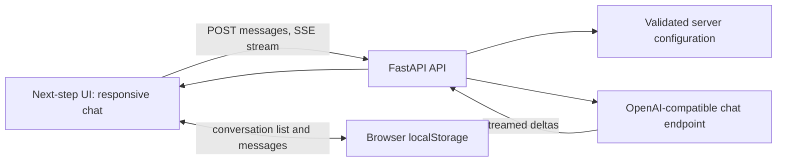

# General Purpose AI Agent

A working Phase 1 and Phase 2 MVP: a browser chat interface backed by a FastAPI service, with OpenAI-compatible model streaming and browser-persisted conversation history. The architecture keeps model access on the server so provider credentials never enter the frontend.

## Requirements

- Python 3.10+
- An API key and endpoint for an OpenAI-compatible Chat Completions API (OpenAI works with the defaults)

## Run locally

```powershell
py -m venv .venv
.venv\Scripts\Activate.ps1
pip install -r requirements.txt
Copy-Item .env.example .env
# Edit .env and set LLM_API_KEY (and model/base URL if needed)
uvicorn backend.app:app --reload
```

Open http://127.0.0.1:8000. `GET /api/health` reports service and model configuration without revealing secrets. The chat endpoint streams Server-Sent Events (SSE) and returns clear errors if the provider is unavailable or not configured.

## Publish a public website

The project includes `render.yaml` for a free Render web service. Create a **public GitHub repository** for this app, then from this folder run:

```powershell
git init
git add .
git commit -m "Prepare Northstar for public hosting"
git branch -M main
git remote add origin https://github.com/YOUR-ACCOUNT/northstar-ai-agent.git
git push -u origin main
```

Replace the remote with the URL of your public repository. Anyone can view the source code, so do not commit `.env`, API keys, or passwords; `.env` is excluded by `.gitignore`. In Render, connect that repository and deploy its Blueprint. When Render asks for the two secret values, enter a **new Gemini API key** as `LLM_API_KEY` and choose a strong `APP_ACCESS_PASSWORD` of at least 14 characters. Share the deployed `https://your-service.onrender.com` URL and that password with the people who should use the site. Do not put either secret in source files.

Render's free services sleep after 15 minutes without traffic and can take about a minute to wake. The chat route is password protected in production. The health endpoint and static UI are public; the model API key remains on the server.

## Configuration

Copy `.env.example` to `.env`. `LLM_BASE_URL` is the API root (for example `https://api.openai.com/v1`); `LLM_MODEL` must be available to your account. Never commit `.env` or expose its key to browser code.

## Architecture (Phase 1)



The MVP intentionally keeps chat state in the browser, avoiding a database and authentication service before there is a deployment/user model. The API validates bounded input, forwards only the current conversation context, and streams model output. Provider credentials stay server-side. Same-origin hosting avoids permissive CORS. The UI can later be moved to Next.js without changing the provider boundary.

### Planned modules

- `backend/`: HTTP API, config, provider adapter.
- `frontend/`: static MVP interface (chat, history, settings, streaming).
- `docs/architecture.md`: component boundaries, data flow, and staged evolution.

## Current scope and next phases

Implemented: architecture, responsive chat UI, streaming model responses, local conversation history, model settings, health endpoint, input validation, and provider error handling.

Not in this MVP: agent planning/tool execution, web research, file analysis, server-side accounts or persistent storage, vector search, and authentication. These need explicit tool permissions, storage policy, sandboxing, and evaluation before being connected. Phase 3 can add a bounded planner and typed tools behind the same API; Phase 4 can add retrieval and document workflows; Phase 5 should add tests/evaluations; Phase 6 can add container deployment.
